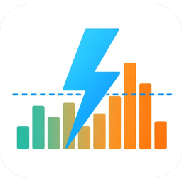

<p align="center">
  
</p>

# Dynamic Energy Tariff Compare for Home Assistant

[](https://hacs.xyz/docs/faq/custom_repositories/)
[](https://github.com/TUNER88/ha-dynamic-energy-tariff-compare/releases)
[](https://github.com/TUNER88/ha-dynamic-energy-tariff-compare/actions/workflows/ci.yml)
[](LICENSE)

**What would you pay on a dynamic electricity tariff, with your real consumption?**

This integration takes your real consumption from your smart meter (e.g. Home Assistant's
**EDL21** integration, Wh or kWh) and prices every quarter hour with the **final all-in price**
of a dynamic tariff. It then compares the result with your current **fixed-price tariff**.

* **Tibber Germany, built in:** enter your postcode and the integration fetches Tibber's
  15-minute all-in prices (energy, taxes/levies, grid fee, VAT) for it. No Tibber account and no
  other integration needed. See [Tibber Germany by postcode](#tibber-germany-by-postcode-built-in).
* **Any other dynamic tariff** (Rabot Energy, Octopus dynamicOctopus, tado° Energy, 1KOMMA5°
  Dynamic Pulse, …) via a **price sensor you already have**: your provider's integration or
  EPEX Spot / Nord Pool configured with your surcharges. The price sensor must already contain
  **everything** (energy, grid fee, taxes, levies, VAT, provider markup).
* 15-minute price lists in the sensor's attributes are used when present (the day-ahead market
  moved to a 15-minute MTU on 1 Oct 2025); otherwise the sensor's current state is used.
* Each kWh is assigned to the quarter hour in which it was consumed. Readings that span
  several slots are split proportionally by time.
* Totals survive restarts. A **backfill** action computes the past weeks from the recorder
  statistics, so you get a result right away.

## How the calculation works

For every 15-minute slot *s* with consumption *E(s)* (kWh):

```
dynamic_cost  = Σ E(s) × price(s)         +  months × dynamic_monthly_fee
fixed_cost    = Σ E(s) × fixed_price      +  months × fixed_base_fee
savings       = fixed_cost − dynamic_cost        (positive = dynamic tariff is cheaper)
```

* `price(s)` is Tibber's all-in price for your postcode, or the price sensor's value **as is**: pick a sensor that already includes all surcharges,
  e.g. your provider's integration like Tibber, or EPEX Spot with surcharges configured.
  Nothing is added on top.
* All values are **gross** (incl. VAT).
* Monthly fees are prorated over the tracked time (1 month = 30.44 days).

## Installation

### HACS (custom repository)

[](https://my.home-assistant.io/redirect/hacs_repository/?owner=TUNER88&repository=ha-dynamic-energy-tariff-compare&category=integration)

Or manually: HACS → ⋮ → *Custom repositories* → `https://github.com/TUNER88/ha-dynamic-energy-tariff-compare`,
type *Integration* → install **Dynamic Energy Tariff Compare** → restart Home Assistant.

### Manual

Download `dynamic_energy_tariff_compare.zip` from the
[latest release](https://github.com/TUNER88/ha-dynamic-energy-tariff-compare/releases/latest) and unpack it into
`<config>/custom_components/dynamic_energy_tariff_compare/`. Then restart Home Assistant.

The integration ships its own icon and logo in
`custom_components/dynamic_energy_tariff_compare/brand/`. Home Assistant **2026.3 or newer**
shows them natively in *Settings → Devices & services*
([developer docs](https://developers.home-assistant.io/docs/core/integration/brand_images/)).
Older versions show a placeholder; everything else works the same. The HACS dashboard
itself may still show a placeholder until HACS supports local brand folders.

### Set up

*Settings → Devices & services → Add integration → Dynamic Energy Tariff Compare*, then choose
the price source:

1. **Tibber Germany by postcode** (recommended in Germany): postcode + grid import sensor. The
   next page shows the current price for your postcode and Tibber's monthly fees, which are
   prefilled as the dynamic tariff's monthly fee. Enter your fixed tariff.
2. **Existing price sensor**: any provider, see [price data](#recommended-integrations-for-price-data).

All options can be changed later via *Configure*, including the sensors and the postcode. To
switch the price source, add a new entry (and delete the old one).

## Configuration

| Option | Meaning | Example default |
|---|---|---|
| Provider name | Optional, for display only (device / entry name). Entity IDs don't change | – |
| Grid import energy sensor | `total_increasing` meter, e.g. EDL21 *Positive active energy total* / OBIS 1.8.0. Any `device_class: energy` sensor; the unit (Wh, kWh, MWh, GWh) is converted automatically | – |
| Postcode | *Tibber Germany only.* 5-digit German postcode; checked against Tibber when saved | – |
| Price sensor | *Price sensor only.* Final all-in price per kWh, see [price data](#recommended-integrations-for-price-data) | – |
| Price unit | *Price sensor only.* *Auto-detect* uses the sensor's `unit_of_measurement` (€/kWh, ct/kWh, €/MWh, also `EUR / kWh`, `Cent/kWh`, …). Without a usable unit the value decides: below 2 → €/kWh, 2–200 → ct/kWh, above 200 → €/MWh (a warning is logged). Select the unit manually if that's wrong | Auto-detect |
| Fixed tariff energy price | your current Arbeitspreis, ct/kWh gross | 32.00 |
| Fixed tariff base fee | your current Grundpreis, €/month gross | 12.00 |
| Dynamic tariff monthly fee | the dynamic provider's base fee, €/month gross. If the grid base fee / metering of the dynamic tariff differs from your fixed tariff, add the difference here. *Tibber Germany:* prefilled with Tibber's monthly fees for your postcode | 5.99 |

> ⚠️ **The defaults are only examples.** Copy the real values from your current contract or
> bill and from the dynamic provider's price calculator for your postcode (see below).
>
> Changed values apply to new consumption only. Press **Reset** and then **Backfill** to
> recalculate.

**Upgrading from 0.2.x:** existing entries are migrated automatically. The removed options
(energy-charts.info fallback, *final price* toggle, markup, grid fee, levies, VAT, grid base fee)
are dropped; the price sensor is now always treated as the final price. Entries that used the
energy-charts.info fallback keep loading but need a price sensor: open *Configure* and select one.
The `current_spot_price` sensor was removed; use `current_dynamic_price`.

**Upgrading from 0.3.x:** existing entries keep using their price sensor. To use the built-in
Tibber Germany prices instead, add a new entry with *Tibber Germany by postcode*.

### Finding the values for your postcode

Most dynamic-tariff providers show a price breakdown after you enter your postcode and annual
consumption. You need the monthly fee for this integration; the per-kWh components belong into
the price sensor (e.g. as EPEX Spot surcharges) unless your provider's integration delivers the
all-in price anyway.

| Provider | Dynamic tariff | What their website says (checked Oct 2026) | Where to look |
|---|---|---|---|
| Tibber | Smart Dynamic | 15-minute wholesale prices; Tibber fee 5.99 €/month | [tibber.com/de](https://tibber.com/de) → price calculator |
| Rabot Energy | dynamic tariff | price follows the spot price set every 15 minutes, plus taxes, levies, grid fees and a monthly base fee | [rabot.energy](https://www.rabot.energy/) → tariff calculator |
| Octopus Energy Germany | dynamicOctopus | price changes every 15 minutes based on EPEX day-ahead prices; smart meter required | [octopusenergy.de/dynamic-octopus](https://octopusenergy.de/dynamic-octopus) |
| tado° Energy (formerly aWATTar) | tado° HOURLY | **hourly** EPEX Spot DE prices; base fee 4.58 €/month plus grid fees and metering | [energy.tado.com/tariffs/hourly](https://energy.tado.com/tariffs/hourly) → Preisrechner |
| 1KOMMA5° | Dynamic Pulse | dynamic tariff combined with their Heartbeat energy management | [1komma5.com/de](https://1komma5.com/de/) |

For tariffs billed **hourly** (e.g. tado° HOURLY), select a price sensor with hourly prices
(e.g. EPEX Spot configured for 60 minutes). Each hourly price is then applied to all four
quarter hours.

## Tibber Germany by postcode (built in)

The integration reads the price data that Tibber's public price calculator on
[tibber.com/de](https://tibber.com/de) shows for a postcode
(`https://tibber.com/de/api/lookup/price-overview?postalCode=<postcode>`). No account or token is
needed. What the response contains (checked Oct 2026, postcode 07646):

* **15-minute prices** (96 per day) for **yesterday, today and tomorrow**, in local time, as
  `priceIncludingVat` in €/kWh. This is the final per-kWh price.
* Each price has components, all incl. VAT: `power` (the EPEX day-ahead price incl. VAT, no
  Tibber markup), `taxes` (taxes and levies) and `grid` (grid fee for the postcode's grid
  operator). Example for 07646 on 10 Oct 2026, 13:00: 16.29 ct = power 0 + taxes 9.67 +
  grid 6.62. Taxes and grid differ by postcode.
* **Monthly fees** for the postcode, e.g. 07646: 15.64 € = Tibber service fee 5.99 + meter
  operator 0.96 + grid 8.69. The total is prefilled as *dynamic tariff monthly fee*. It matches
  a fixed tariff's *Grundpreis* that also includes metering and the grid base price, which is
  usual in Germany.
* Until the day-ahead prices are published (early afternoon), *tomorrow* only contains
  placeholders without the `power` part. They are ignored.

How the integration uses it:

* Fetched every **30 minutes** (Tibber's cache is valid until the next full hour), so tomorrow's
  prices appear in the afternoon.
* Prices are stored in Home Assistant (`.storage`) for **400 days**, so restarts and later
  backfills can use every price fetched since installation.
* The *current dynamic price* sensor shows the price of the current quarter hour with the
  attributes `components_ct`, `tibber_monthly_fees_eur`, `postcode`, `last_price_fetch` and the
  `today` / `tomorrow` lists.
* The endpoint is **not an official API**. Tibber can change or remove it at any time. If a
  fetch fails, the last prices are kept, the error is shown in the sensor's `last_error`
  attribute and consumption waits in *pending energy* (up to 3 days) until prices arrive.

## Recommended integrations for price data

Only needed for the *Existing price sensor* source.

| Integration | Install | 15-min support | What this integration reads | Use as all-in price? |
|---|---|---|---|---|
| [Tibber](https://www.home-assistant.io/integrations/tibber/) (core) | built in | n/a | current state (price of your Tibber contract) | yes, **only if you already have a Tibber account** |
| [Tibber Pricing DE](https://github.com/cyberjunky/home-assistant-tibber_pricing_de) (`cyberjunky/home-assistant-tibber_pricing_de`) | HACS (custom repository) | no, **hourly** | attribute `prices` = today's hours `[{timestamp, price}]` of the *Current Price* sensor | yes: Tibber's per-kWh price for your postcode incl. energy, taxes/levies, grid fee and VAT. No Tibber account needed. See [notes](#tibber-pricing-de-no-account) |
| [EPEX Spot](https://github.com/mampfes/ha_epex_spot) (`mampfes/ha_epex_spot`) | HACS | yes, selectable 15 or 60 min since v4.0.0 | attribute `data` = `[{start_time, end_time, price_per_kwh}]` | use the *Total price* sensor with your surcharges and tax configured in EPEX Spot |
| [Nord Pool](https://github.com/custom-components/nordpool) (`custom-components/nordpool`) | HACS | quarter-hour price updates since v0.0.18 | attributes `raw_today` / `raw_tomorrow` | only with your additional costs configured (`additional_costs` template) |
| [Nord Pool](https://www.home-assistant.io/integrations/nordpool/) (core) | built in | yes, the docs say it switches to the 15-min MTU automatically | current state only | no, spot price without VAT and other costs; wrap it in a template sensor that adds them |

### Tibber Pricing DE (no account)

Pick **`sensor.<name>_current_price`** (*Tibber Pricing DE Current Price*). It is the only
entity with the `prices` list; the other entities (next hour, highest/lowest today and their
hours) are not needed. Notes from its source code (v1.0.0) and the Tibber API it reads:

* `price` = Tibber's `priceIncludingVat` = energy (`power`, the spot price without markup) +
  `taxes` + `grid` incl. VAT, so it is the final per-kWh price. Monthly fees are separate.
* The entity has **no unit** (it isn't a sensor entity with a unit); the value is €/kWh. Auto-detect
  handles this, or set *Price unit* to €/kWh.
* The list is hourly, with local times and without an offset. Each hour is applied to its four quarter hours.
  Only today is included (no tomorrow).
* Its state is looked up for *now + 1 h* in the code, so it shows the **next** hour's price.
  This integration uses the `prices` list instead, which has the correct hours (checked
  against EPEX day-ahead prices).
* It has no `state_class`, so Home Assistant keeps no long-term statistics for it. Backfill can
  only use the recorded states (default 10 days).
* Its `monthly` attribute lists Tibber's monthly fees for your postcode (Tibber service fee,
  meter operator, grid base price). If your fixed tariff's base fee covers the same items,
  enter the `monthly` total (`priceIncludingVat`) as *dynamic tariff monthly fee*.

### Other sensors

Any other sensor also works, e.g. a template sensor that adds your surcharges to a spot price.
Price lists are found in any attribute that holds a list of entries with a time key (`start`,
`start_time`, `startsAt`, `from`, `time`, `timestamp`, `date` + `hour`, …) and a price key
(`price`, `total`, `value`, `price_per_kwh`, `priceIncludingVat`, …). Times without an offset are
read as local time. Entries without an end last until the next entry (max. 1 h), so hourly
lists are expanded to four quarter hours. Without a list, the sensor's current state is used
for each slot.

## Entities

Entity IDs are fixed (also when you set a provider name):

| Entity ID | Unit | Class | Notes |
|---|---|---|---|
| `sensor.dynamic_energy_tariff_compare_current_dynamic_price` | ct/kWh | measurement | current all-in price; attributes `today` / `tomorrow` (15-min lists), `fixed_price_ct`, `source`, `last_error`; with Tibber Germany also `components_ct`, `tibber_monthly_fees_eur`, `postcode`, `last_price_fetch` |
| `sensor.dynamic_energy_tariff_compare_dynamic_energy_cost` | EUR | monetary / total | energy only |
| `sensor.dynamic_energy_tariff_compare_fixed_energy_cost` | EUR | monetary / total | energy only |
| `sensor.dynamic_energy_tariff_compare_dynamic_total_cost` | EUR | monetary / total | + prorated dynamic monthly fee |
| `sensor.dynamic_energy_tariff_compare_fixed_total_cost` | EUR | monetary / total | + prorated base fee |
| `sensor.dynamic_energy_tariff_compare_savings` | EUR | monetary / total | attributes `savings_per_month_eur`, `projected_savings_per_year_eur`, `months_tracked`, `tracking_since`, `last_backfill` |
| `sensor.dynamic_energy_tariff_compare_consumption` | kWh | energy / total_increasing | tracked consumption |
| `sensor.dynamic_energy_tariff_compare_avg_dynamic_price` | ct/kWh | measurement | consumption-weighted |
| `sensor.dynamic_energy_tariff_compare_avg_dynamic_price_incl_fees` | ct/kWh | measurement | |
| `sensor.dynamic_energy_tariff_compare_avg_fixed_price_incl_fees` | ct/kWh | measurement | |
| `sensor.dynamic_energy_tariff_compare_pending_energy` | kWh | diagnostic | consumption still waiting for a price |
| `sensor.dynamic_energy_tariff_compare_avg_dynamic_price_24h` | ct/kWh | measurement | consumption-weighted Ø dynamic energy price, **last 24 h** (rolling); window figures as attributes, see [rolling windows](#rolling-windows-last-24-h-30-days-365-days) |
| `sensor.dynamic_energy_tariff_compare_avg_dynamic_price_30d` | ct/kWh | measurement | same, **last 30 days** |
| `sensor.dynamic_energy_tariff_compare_avg_dynamic_price_365d` | ct/kWh | measurement | same, **last 365 days** |
| `sensor.dynamic_energy_tariff_compare_savings_24h` | EUR | monetary | fixed − dynamic total cost incl. prorated fees, **last 24 h**; same attributes |
| `sensor.dynamic_energy_tariff_compare_savings_30d` | EUR | monetary | same, **last 30 days** |
| `sensor.dynamic_energy_tariff_compare_savings_365d` | EUR | monetary | same, **last 365 days** |
| `button.dynamic_energy_tariff_compare_backfill` | | config | backfill 30 days |
| `button.dynamic_energy_tariff_compare_reset` | | config | reset all totals |

### Rolling windows (last 24 h, 30 days, 365 days)

The `avg_dynamic_price_<window>` and `savings_<window>` sensors look back from *now*. They
update every 15 minutes even when the meter doesn't report. Both carry the same attributes:

| Attribute | Meaning |
|---|---|
| `window`, `window_start` | `24h` / `30d` / `365d` and the window's start (local time) |
| `covered_from` | later of window start and tracking start: fees are prorated from here |
| `consumption_kwh` | consumption with a known dynamic price (compared on both sides) |
| `unpriced_kwh` | consumption without a price (pending or skipped), not compared |
| `avg_dynamic_price_ct`, `avg_dynamic_price_incl_fees_ct` | Ø dynamic energy price, and incl. the prorated monthly fee |
| `avg_fixed_price_ct`, `avg_fixed_price_incl_fees_ct` | Ø fixed energy price, and incl. the prorated base fee |
| `dynamic_energy_cost_eur`, `fixed_energy_cost_eur` | energy cost in the window |
| `dynamic_fees_eur`, `fixed_fees_eur` | monthly fees × tracked part of the window / 30.44 days |
| `dynamic_total_cost_eur`, `fixed_total_cost_eur`, `savings_eur` | totals and their difference |

* Consumption and energy cost are stored per 15-minute slot (in `.storage`, restart-safe).
  To keep the file small, slots older than 2 days are merged into hours and hours older than
  35 days into days (UTC). Data older than 366 days is dropped. The 365-day window's start
  therefore falls into a daily bucket that is counted proportionally.
* Backfill fills the windows too; *Reset* clears them.
* The fixed energy cost uses the fixed price that was configured when the energy was priced
  (backfill: the current one).

## Backfill

```yaml
action: dynamic_energy_tariff_compare.backfill
data:
  days: 60        # days before the current tracking start
response_variable: result
```

* **Energy:** recorder **5-minute short-term statistics** where they still exist (default
  retention ≈ 10 days), otherwise **hourly long-term statistics**. Hourly energy is spread
  evenly over the four quarter hours, so shifts in usage within an hour are lost.
* **Prices (Tibber Germany):** Tibber's endpoint has **no history**; it only serves yesterday,
  today and tomorrow. Backfill uses the stored prices: yesterday and today right after setup,
  and every day since installation later on. Older consumption gets `no_price_history` /
  `unpriced_kwh_skipped`.
* **Prices (price sensor):** only the selected price sensor's recorder data: recorded states and price-list
  attributes (default retention 10 days), else the sensor's **statistics** (5-minute / hourly
  mean, kept long term if the sensor has a `state_class`, as core Tibber does).
  If no price is recorded for the period, the result says `no_price_history` and nothing is
  added. Consumption without a recorded price is excluded from both tariffs and reported as
  `unpriced_kwh_skipped`.
* Each run only fills the period **before** the current tracking start, so nothing is
  counted twice. Run it again with more days to go further back.
* Today's tariff values are used for the whole historic period.
* The added amount appears in the cost statistics at the time of the backfill.

`dynamic_energy_tariff_compare.reset` clears all totals.

## Dashboard

A complete, ready-to-paste dashboard is in [`examples/dashboard.yaml`](examples/dashboard.yaml).
Create a new dashboard → ⋮ → *Edit* → ⋮ → *Raw configuration editor* → paste.

Required:

* **View "Overview"**: built-in cards only (tile, entities, statistics-graph, history-graph).
* **View "Charts"**: [ApexCharts Card](https://github.com/RomRider/apexcharts-card) from HACS (Frontend).
* Monthly cards: the `utility_meter` helpers from [`examples/utility_meter.yaml`](examples/utility_meter.yaml).

### 1. Built-in cards: key figures and daily/monthly comparison

```yaml
type: grid
columns: 2
square: false
cards:
  - type: tile
    entity: sensor.dynamic_energy_tariff_compare_savings
    name: Savings with dynamic tariff
  - type: tile
    entity: sensor.dynamic_energy_tariff_compare_consumption
  - type: tile
    entity: sensor.dynamic_energy_tariff_compare_avg_dynamic_price_incl_fees
    name: Ø dynamic incl. fees
  - type: tile
    entity: sensor.dynamic_energy_tariff_compare_avg_fixed_price_incl_fees
    name: Ø fixed incl. fees
```

```yaml
type: statistics-graph
title: Monthly cost – dynamic vs. fixed
period: month          # or: day
days_to_show: 365
chart_type: bar
stat_types: [change]
entities:
  - entity: sensor.dynamic_energy_tariff_compare_dynamic_total_cost
    name: Dynamic
  - entity: sensor.dynamic_energy_tariff_compare_fixed_total_cost
    name: Fixed
```

Rolling windows (last 24 h, 30 days, 365 days): average prices and savings, plus a table
built from the attributes of the `avg_dynamic_price_*` sensors.

```yaml
type: grid
columns: 3
square: false
cards:
  - type: tile
    entity: sensor.dynamic_energy_tariff_compare_avg_dynamic_price_24h
    name: Ø dynamic 24 h
  - type: tile
    entity: sensor.dynamic_energy_tariff_compare_avg_dynamic_price_30d
    name: Ø dynamic 30 days
  - type: tile
    entity: sensor.dynamic_energy_tariff_compare_avg_dynamic_price_365d
    name: Ø dynamic 365 days
  - type: tile
    entity: sensor.dynamic_energy_tariff_compare_savings_24h
    name: Saved 24 h
  - type: tile
    entity: sensor.dynamic_energy_tariff_compare_savings_30d
    name: Saved 30 days
  - type: tile
    entity: sensor.dynamic_energy_tariff_compare_savings_365d
    name: Saved 365 days
```

```yaml
type: markdown
title: Rolling windows
content: |
  {{ '–' if x is none else x }}
  
  | | 24 h | 30 days | 365 days |
  |:--|--:|--:|--:|
  | Consumption (kWh) | {{ v(e, 'consumption_kwh') }} |
  | Ø dynamic energy (ct/kWh) | {{ v(e, 'avg_dynamic_price_ct') }} |
  | Ø dynamic incl. fees (ct/kWh) | {{ v(e, 'avg_dynamic_price_incl_fees_ct') }} |
  | Ø fixed incl. fees (ct/kWh) | {{ v(e, 'avg_fixed_price_incl_fees_ct') }} |
  | Dynamic cost (€) | {{ v(e, 'dynamic_total_cost_eur') }} |
  | Fixed cost (€) | {{ v(e, 'fixed_total_cost_eur') }} |
  | **Savings (€)** | **{{ v(e, 'savings_eur') }}** |
```

### 2. ApexCharts: today/tomorrow 15-min price vs. fixed price

Columns show the effective dynamic price per quarter hour. They are green when cheaper than
your fixed price and red when more expensive. The fixed price is drawn as a flat line.

```yaml
type: custom:apexcharts-card
header: {show: true, title: Dynamic price (15 min) vs. fixed price, show_states: true}
graph_span: 2d
span: {start: day}
now: {show: true, label: Now}
series:
  - entity: sensor.dynamic_energy_tariff_compare_current_dynamic_price
    name: Cheaper than fixed
    type: column
    color: "#2e7d32"
    data_generator: |
      const fixed = entity.attributes.fixed_price_ct;
      return [...(entity.attributes.today || []), ...(entity.attributes.tomorrow || [])]
        .map(p => [new Date(p.start).getTime(), p.price <= fixed ? p.price : null]);
  - entity: sensor.dynamic_energy_tariff_compare_current_dynamic_price
    name: More expensive than fixed
    type: column
    color: "#c62828"
    data_generator: |
      const fixed = entity.attributes.fixed_price_ct;
      return [...(entity.attributes.today || []), ...(entity.attributes.tomorrow || [])]
        .map(p => [new Date(p.start).getTime(), p.price > fixed ? p.price : null]);
  - entity: sensor.dynamic_energy_tariff_compare_current_dynamic_price
    name: Fixed price
    type: line
    curve: stepline
    color: "#1565c0"
    data_generator: |
      const fixed = entity.attributes.fixed_price_ct;
      const start = new Date(); start.setHours(0, 0, 0, 0);
      return [[start.getTime(), fixed], [start.getTime() + 2 * 86400000, fixed]];
```

### 3. Cumulative cost comparison

```yaml
type: custom:apexcharts-card
header: {show: true, title: Cumulative cost – last 30 days, show_states: true}
graph_span: 30d
series:
  - entity: sensor.dynamic_energy_tariff_compare_dynamic_total_cost
    name: Dynamic
    statistics: {type: state, period: hour}
  - entity: sensor.dynamic_energy_tariff_compare_fixed_total_cost
    name: Fixed
    statistics: {type: state, period: hour}
  - entity: sensor.dynamic_energy_tariff_compare_savings
    name: Savings
    statistics: {type: state, period: hour}
```

### 4. Monthly bars via `utility_meter`

```yaml
# configuration.yaml – see examples/utility_meter.yaml for the full set (incl. daily)
utility_meter:
  dynamic_energy_tariff_compare_dynamic_monthly:
    name: Dynamic Energy Tariff Compare dynamic monthly
    source: sensor.dynamic_energy_tariff_compare_dynamic_total_cost
    cycle: monthly
  dynamic_energy_tariff_compare_fixed_monthly:
    name: Dynamic Energy Tariff Compare Fixed monthly
    source: sensor.dynamic_energy_tariff_compare_fixed_total_cost
    cycle: monthly
  dynamic_energy_tariff_compare_savings_monthly:
    name: Dynamic Energy Tariff Compare Savings monthly
    source: sensor.dynamic_energy_tariff_compare_savings
    cycle: monthly
    net_consumption: true   # savings can go down
```

```yaml
type: custom:apexcharts-card
header: {show: true, title: Monthly cost – dynamic vs. fixed}
graph_span: 365d
span: {end: month}
series:
  - entity: sensor.dynamic_energy_tariff_compare_dynamic_monthly
    name: Dynamic
    type: column
    statistics: {type: change, period: month, align: start}
  - entity: sensor.dynamic_energy_tariff_compare_fixed_monthly
    name: Fixed
    type: column
    statistics: {type: change, period: month, align: start}
```

The utility meters also give you "this month so far" values for tile cards
(`sensor.dynamic_energy_tariff_compare_savings_monthly`, …).

## Known limitations

* This is an estimate, not a bill. Providers bill from their own meter data and may have
  extra components (bonuses, price caps, minimum terms).
* Only grid **import** is compared. Feed-in compensation is not included. Use the 1.8.0 sensor.
* Tibber Germany: unofficial endpoint (see above); no prices before the day before installation.
* Reduced grid fees under §14a EnWG (time-variable Netzentgelte, Modul 3) are only covered if
  your price sensor includes them.
* If a slot's price is missing (price sensor unavailable), its consumption waits up
  to 3 days in *pending energy*. Until then it is excluded from savings on both sides.
* Meter resets or replacements: negative jumps are ignored and the new value becomes the
  baseline. Consumption while the meter sensor is unavailable is spread evenly over the gap.
* Changed tariff values are not applied retroactively (use reset + backfill).
* Version shown for a manual git checkout is the manifest placeholder; releases carry the
  real version (see [CONTRIBUTING.md](CONTRIBUTING.md)).

## Contributing & releases

See [CONTRIBUTING.md](CONTRIBUTING.md). Every merged PR is released automatically.
